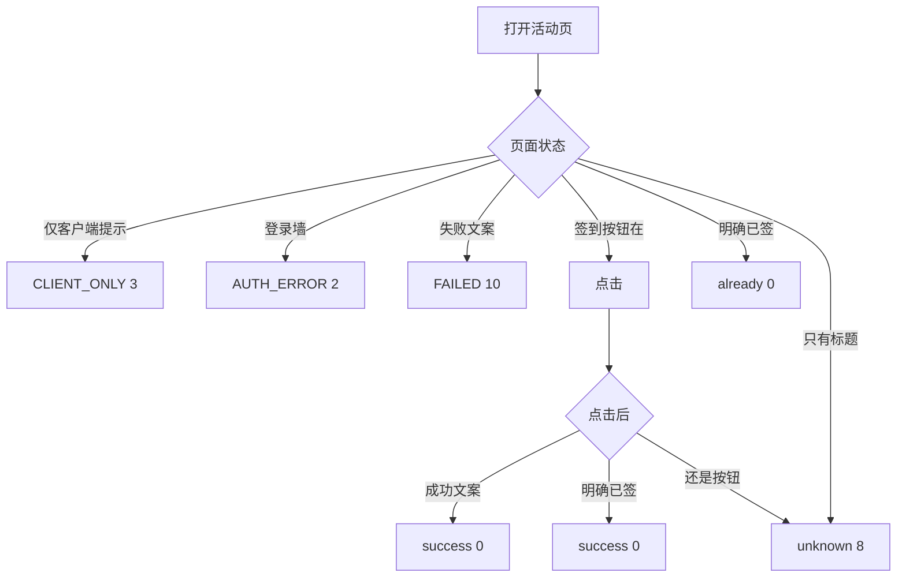

# doubao-checkin

[](https://github.com/yuw868349-commits/doubao-checkin/actions/workflows/ci.yml)
[](https://www.python.org/)
[](LICENSE)

豆包「额度天天送」每日签到。打开活动页，点一次签到，把结果写进 `data/last-result.json`，定时任务读这个文件就行。

这不是官方项目。页面改版、规则收紧、客户端校验升级，都会让它失效。自动化签到可能违反服务条款，账号有被风控的风险，用不用自己判断。

## 它做什么

- 每天签到一次，平时 200 额度、周一翻倍（以页面实际显示为准）
- 已签过就跳过，不重复点；`silent` 和 `silent-poll` 都能识别当天成功记录
- 结果落 JSON，退出码能区分登录失效、网络失败、被判定成网页端、页面明确拒绝
- macOS / Windows 直接读豆包电脑版客户端凭据，零配置
- 服务器或容器可以用 Cookie 注入
- 自带 `doctor` 自检、日志、失败截图、Webhook 通知
- 每个结果码的含义和处置方式写在下面，定时任务能直接消费

## 它不做什么

- 不刷额度、不批量注册、不处理验证码
- 不保证一直可用。活动页前端校验一改，可能需要改 `state.py` 或 UA 版本号
- 不做多账号。一台机器只认一个登录态
- 不做指纹伪装。UA 之外的浏览器指纹跟真实客户端对不上，官方要查就能查出来

## 快速开始

需要 Python 3.10+ 和能跑 Playwright 的环境。

```bash
git clone https://github.com/yuw868349-commits/doubao-checkin.git
cd doubao-checkin

python3 -m venv .venv
source .venv/bin/activate      # Windows: .venv\Scripts\activate
pip install ".[dev]"
python -m playwright install chromium

python checkin.py doctor
python checkin.py run
```

`doctor` 会检查 Playwright、Chromium、凭据、数据目录和截图目录能不能写，不联网。

## 登录方式

| 方式 | 适用 | 怎么配 |
| --- | --- | --- |
| 客户端凭据 | macOS / Windows，装过豆包电脑版并登录 | 不用配，脚本自己读 |
| 手动登录 | 有桌面环境的机器 | `python checkin.py login` |
| Cookie 注入 | Linux、容器、GitHub Actions | `DOUBAO_COOKIES_JSON` 环境变量，或 `data/cookies.json` |

优先级是：环境变量 → `data/cookies.json` → 客户端凭据 → `data/profile`。

`run` 遇到 `AUTH_ERROR` 时，会跳过失效的来源，用下一个凭据再试一次。只试一次，避免登录墙死循环。

### macOS / Windows 客户端

macOS 从钥匙串取 `Doubao Safe Storage` 密钥，解 `~/Library/Application Support/Doubao` 下的 `Cookies`，AES-128-CBC 的 PKCS#7 与老版空格填充都能处理。

Windows 从 `%LOCALAPPDATA%` 找豆包客户端目录，用 DPAPI 解 `Local State` 里的密钥，再解 Cookie 库。客户端开着的时候 Cookie 库会被占用，脚本先普通拷贝（连 `-wal` 一起带走），失败再用 `esentutl` 备份拷贝；还失败就关掉客户端跑一次，或者直接走 Cookie 注入。

AES-GCM 会逐条校验 tag，校验不过的 Cookie 直接丢弃，不会把带垃圾尾巴的值拿去用。v20 / App-Bound 加密暂不支持，遇到会在 `detail` 里写明原因，不会拿空 Cookie 硬跑。

### 手动登录

```bash
python checkin.py login
```

会打开有头浏览器，脚本检测到 `sessionid` 后自动继续，不用回终端按键。登录态存在 `data/profile`，同时把 `doubao.com` 的 Cookie 导出到 `data/cookies.json`（权限 600）。

`login` 的结果单独记为 `command=login`，不会污染当天的签到状态。登录完直接跑 `silent`，不会被误判成「今天已经签过」。

没有桌面的服务器跑不了这一步，用 Cookie 注入。

### Cookie 注入

最少需要这些字段：

```json
[
  {
    "name": "sessionid",
    "value": "<你的值>",
    "domain": ".doubao.com",
    "path": "/"
  }
]
```

也可以直接放浏览器扩展导出的完整数组，脚本认 `name` / `value` / `domain`（或 `host_key`）/ `path` / `expires` / `httpOnly` / `sameSite`。

```bash
export DOUBAO_COOKIES_JSON="$(cat cookies.json)"
python checkin.py run
```

`expires` 传 0、负数或毫秒时间戳都能处理：0 和负数当会话 Cookie，毫秒会换算成秒。不传就不设过期时间。

细节和取值注意看 [docs/cookies.md](docs/cookies.md)。

## 命令

| 命令 | 说明 |
| --- | --- |
| `python checkin.py run` | 执行一次，结果打到 stdout |
| `python checkin.py silent` | 执行一次，不打印；结果写日志和 `last-result.json`，当天成功过就直接跳过 |
| `python checkin.py silent-poll` | 同 `silent`，当天没成功时在网络、超时或未知状态上重试 |
| `python checkin.py doctor` | 离线自检 |
| `python checkin.py login` | 手动登录，写 `data/profile` 并导出 Cookie |

通用参数：

| 参数 | 说明 |
| --- | --- |
| `--url` | 换活动页地址 |
| `--headed` | 显示浏览器窗口 |
| `--insecure` | 忽略证书错误，只在抓包代理环境用，会打印警告 |
| `--timeout` | 单步超时秒数，默认 15 |
| `--budget` | 整次运行预算秒数，默认 300 |
| `--json` | 输出结构化结果 |
| `--block-resources` | 拦截图片、字体、媒体，页面加载更快 |
| `--notify-webhook` | 需要关注的结果 POST 到这个地址 |

## 结果码

| result | 含义 | 退出码 |
| --- | --- | --- |
| `success` | 签到成功 | 0 |
| `already` | 今天已经签过 | 0 |
| `AUTH_ERROR` | 登录态失效 | 2 |
| `CLIENT_ONLY` | 被判定成网页端 | 3 |
| `NETWORK` | 页面打不开 | 4 |
| `TIMEOUT` | 时间预算或页面操作超时 | 5 |
| `BROWSER` | Chromium / Playwright 异常 | 6 |
| `NO_CREDENTIAL` | 没有可用凭据 | 7 |
| `unknown` | 页面状态没认出来 | 8 |
| `ERROR` | 未预期异常 | 9 |
| `FAILED` | 页面明确提示签到失败 | 10 |

`data/last-result.json` 每次覆盖写，只有本次结果，不含 Cookie。

状态判断的优先级：



按钮存在时一律按未签处理，不会因为页面标题在、按钮还没渲染出来就判成已签。失败文案优先于成功判断，页面说「已抢完」时不会报成功。

## GitHub Actions

仓库带了 `.github/workflows/checkin.yml`，每天 UTC 00:10（北京时间 08:10）跑一次，也可以手动触发。

1. Fork 这个仓库
2. 在 fork 的 Settings → Secrets and variables → Actions 里加 `DOUBAO_COOKIES_JSON`
3. 需要时在 Actions 页面点 `Run workflow`

别人 fork 你的仓库，用不了你仓库里的 Secret，每个 fork 要自己配。别把 Cookie 写进 workflow 文件。

Secret 没配时 workflow 会直接报错退出，不会显示成绿色。失败截图会作为 artifact 上传，保留 7 天。每次运行的摘要写在 job summary 里。

## 部署

仓库带了四种定时任务的配置，按平台挑一个：

| 平台 | 文件 | 说明 |
| --- | --- | --- |
| Linux systemd | `deploy/systemd/` | service 跑一次，timer 每天 08:10 触发 |
| macOS launchd | `deploy/launchd/com.doubao.checkin.plist` | 放 `~/Library/LaunchAgents/` |
| Windows 计划任务 | `deploy/windows/checkin-task.xml` | `schtasks /Create /XML` 导入 |
| Docker | `Dockerfile` | 基于 Playwright 官方镜像，`/data` 挂卷 |

systemd 示例：

```bash
sudo cp deploy/systemd/*.service deploy/systemd/*.timer /etc/systemd/system/
sudo systemctl daemon-reload
sudo systemctl enable --now doubao-checkin.timer
systemctl list-timers doubao-checkin.timer
```

Docker 示例：

```bash
docker build -t doubao-checkin .
docker run --rm -e DOUBAO_COOKIES_JSON="$(cat cookies.json)" -v "$PWD/data:/data" doubao-checkin
```

## 通知

`--notify-webhook` 只在 `needs_attention` 为真的结果上发 POST，成功和已签不打扰：

```bash
python checkin.py silent --notify-webhook https://example.com/hook
```

请求体是 JSON，`text` 字段放一句人能读的摘要，`result` 字段放完整的 `CheckinResult`。企业微信、飞书、Bark、ntfy 的机器人地址都能直接接。

## 日志

默认是带时间戳的文本，`tail -f data/checkin.log` 就能看。要接日志系统，设 `DOUBAO_LOG_FORMAT=json`，每行一个 JSON：

```json
{"ts": "2026-11-23T10:14:30+08:00", "message": "结果：success（签到成功，额度已到账）"}
```

## 项目结构

```text
checkin.py               兼容入口，python checkin.py <命令>
doubao_checkin/
  cli.py                 命令解析、doctor、通知、退出码
  runner.py              浏览器流程：导航、等待、点击、截图
  credentials.py         环境变量 / Cookie 文件 / macOS / Windows 凭据
  state.py               页面文案与状态判断
  report.py              结果码、日志、last-result.json
  config.py              路径、UA、时区、等待时间
tests/                   状态判断、凭据、命令行、浏览器集成测试
deploy/                  systemd / launchd / Windows 计划任务
docs/cookies.md          取 Cookie 的几种方式
Dockerfile               Playwright 官方镜像 + 本项目
```

## 为什么这么做

活动接口带签名参数，纯 `requests` 一开始能跑，改版就废。用浏览器点按钮笨，但坏得慢，出问题还能截图。

活动页会检查 UA 里有没有 `SamanthaDoubao`，脚本默认带 `2.33.3`。这是最脆弱的一环，官方一改校验就会返回 `CLIENT_ONLY`。遇到的话先改 `DOUBAO_CLIENT_UA_VERSION`，还不行就提 issue。

状态判断集中在 `state.py`。判断顺序是失败文案、可点按钮、已签文案、只有标题，最后才是「什么都没认出来」。只有在看到明确的已签文案时才返回 `already`，标题在但按钮不在会返回 `unknown` 并留截图，不会猜成已签。

整次运行有预算（默认 300 秒），避免定时任务被系统强杀之前还没写日志。

`silent` 和 `silent-poll` 都读 `last-result.json` 做幂等判断，只认 `command` 是 `run` / `silent` / `silent-poll` 且北京时区当天成功的记录。`login` 的记录不算。

## 已知限制

- 页面文案改版要改 `doubao_checkin/state.py`，集中在一个文件里
- `sessionid` 大约 30 天过期，之后返回 `AUTH_ERROR`
- `data/profile` 模式在部分环境下会被识别成网页端，优先用客户端凭据或 Cookie
- Windows v20 / App-Bound 加密的 Cookie 解不了
- 客户端 Cookie 全部解密失败时返回 `NO_CREDENTIAL`，`detail` 里写第一条失败原因
- 无头浏览器不是 100% 隐形，官方要封就是会封
- 成功不截图，失败才截图，只保留最近 30 张

## 实测

| 日期 | 环境 | 结果 |
| --- | --- | --- |
| 2026-11-22 | Linux + Cookie 注入 | 签到成功，200 额度 |
| 2026-11-23 | Linux + 本地页面 | 8 个浏览器场景全过，覆盖正常、已签、登录墙、客户端限定、替补按钮文案、延迟渲染、名额抢完、HTTP 404/502 |

客户端凭据路径沿用作者自用脚本的实现。两端的解密与去填充在 `tests/test_credentials.py` 里用 Chromium 真实格式的合成数据覆盖；macOS 的目录发现和 Windows 的目录发现各有一条 mock 测试。Windows 的 DPAPI 调用本身没有在真实 Windows 上跑过 CI，只在代码层拆出 `_dpapi_unprotect` 便于替换。有 Windows 机器的话欢迎提 issue 反馈。

## 安全

Cookie 等同于账号登录凭证。别提交，别发给别人，别贴到 issue 里。

- `data/`、`cookies.json`、`*.log` 已在 `.gitignore`
- `data/` 和 `data/shots/` 权限 700，`cookies.json`、`last-result.json`、日志权限 600
- 日志和结果文件不打印 Cookie 值
- `--insecure` 会在 stderr 打警告，用完记得关掉

## License

MIT
